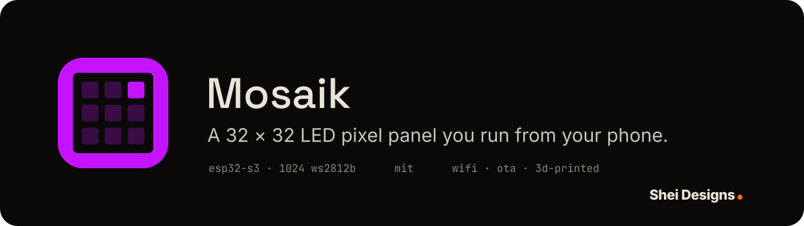
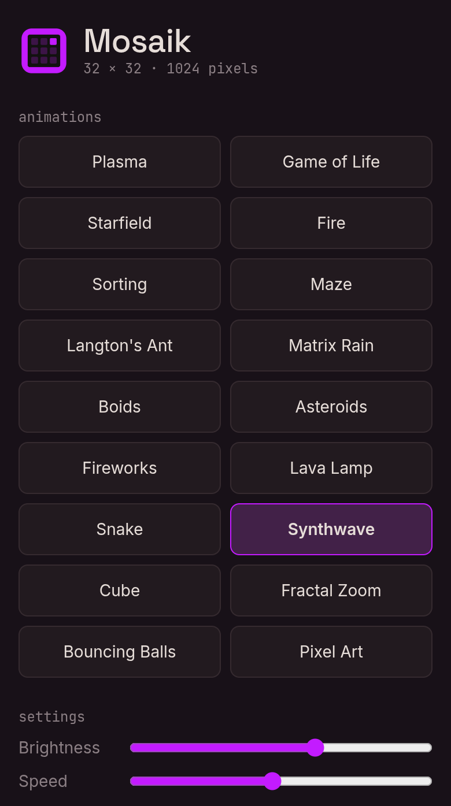
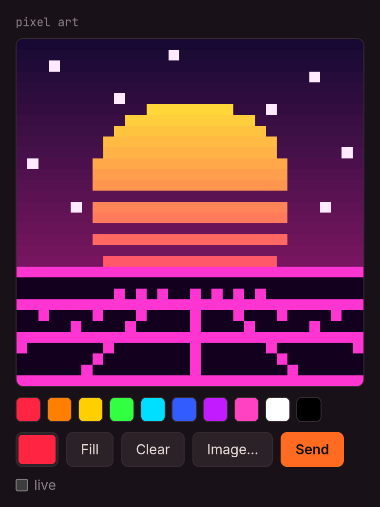
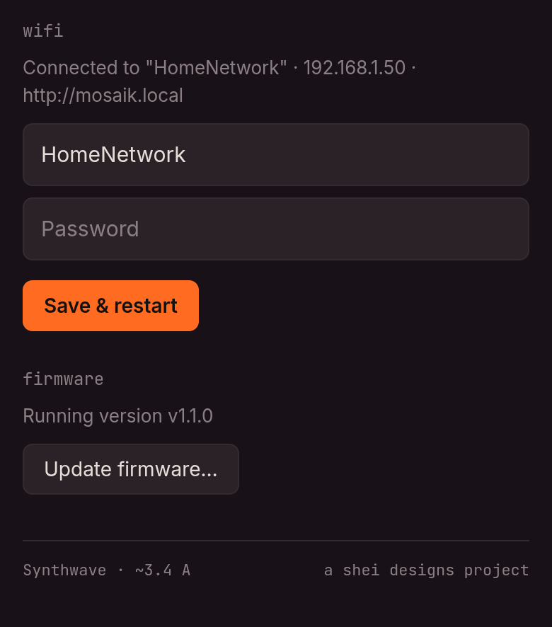

<h1 align="center">
  
</h1>

**Mosaik** is a 320 × 320 mm wall panel of 1,024 RGB pixels: four 8 × 32 WS2812B
flex panels sandwiched between a 3D-printed base and a grid that gives every
LED its own square cell, behind a diffuser. An ESP32-S3 runs 17 generative
animations (Game of Life, boids, maze solving, sorting algorithms,
synthwave and more) and serves a web UI. From your phone you can pick an
animation, paint pixel art or upload a sprite, and update the firmware over
WiFi. No app is needed.

Everything runs on the panel; nothing leaves your network. Open source
under the MIT license, firmware and printable parts alike.

Mosaik is a [Shei Designs](https://sheidesigns.com) project, designed and
built by [Andrew O'Shei](https://andrewoshei.com).

<p align="center">
  
  
  
</p>

## Hardware

- 4x WS2812B 8x32 flexible LED panels (1024 LEDs, 320 x 320 mm total)
- Mean Well LRS-200-5 power supply (5 V / 40 A)
- ESP32-S3-DevKitC-1
- IEC C14 panel-mount mains inlet
- 3D-printed PLA frame, light grid and diffusers (STLs in
  [`3D_print_assets/`](3D_print_assets)), M3/M4 screws
  and PLA glue

**[Bill of Materials](docs/BOM.md)** · **[Build Instructions](docs/BUILD.md)**

## Features

- **Animation engine** running at ~30 FPS (the physical limit of 1024
  WS2812B LEDs on one data line) on core 1, RMT + DMA so WiFi can't glitch
  the strip timing.
- **Animations**: Plasma, Game of Life, Starfield, Fire,
  Sorting (bubble/selection/insertion/quicksort), Maze (DFS carve + BFS
  solve), Langton's Ant, Matrix Rain, Boids (with a red predator that
  hunts the flock's center of mass), Asteroids (self-playing), Fireworks,
  Lava Lamp (metaballs), Snake (self-playing, BFS pathfinding), Synthwave
  (80s sunset + scrolling perspective grid), Cube (spinning 3D wireframe),
  Fractal Zoom (Mandelbrot seahorse-valley dive), Bouncing Balls (physics
  sim with ball-to-ball collisions), Pixel Art.
- **Web UI** (mobile-first, embedded in flash): pick animations, brightness
  and speed sliders, a 32x32 pixel-art editor with live painting, and
  image upload (sprites are scaled to 32x32 with nearest-neighbor
  sampling, aspect ratio preserved).
- **WiFi**: joins your network as a station; falls back to its own access
  point (`Mosaik` / `mosaik123`, then browse to `http://192.168.4.1`)
  if it can't. mDNS: `http://mosaik.local`. Credentials can be set from
  the web UI (stored in NVS, no reflash needed):
  1. connect your phone to the `Mosaik` access point,
  2. open `http://192.168.4.1`, scroll to the **WiFi** section,
  3. enter your network's SSID and password, tap *Save & restart panel*,
  4. rejoin your own WiFi and open `http://mosaik.local`.
  If the saved network is unreachable the panel returns to AP mode, so a
  typo can always be corrected the same way. Saving an empty SSID clears
  the stored credentials.
- **Safety**: gamma correction, global brightness, and a per-frame current
  limiter (`PANEL_MAX_CURRENT_MA`) so a full-white frame can't overload the
  supply.
- Last animation, brightness, speed and pixel-art frame persist across
  reboots (NVS).
- **OTA updates**: flash new firmware over WiFi from the web UI or with
  `curl` — no USB cable needed after the initial flash. Two app slots with
  bootloader rollback: if an update fails to boot, the panel automatically
  falls back to the previous firmware.

## Building

Requires [ESP-IDF](https://docs.espressif.com/projects/esp-idf/en/v5.4/esp32s3/get-started/)
v5.4. The `led_strip` and mDNS components are fetched automatically on the
first build.

```sh
source ~/esp/esp-idf/export.sh
idf.py menuconfig        # -> "Mosaik Configuration": WiFi SSID/password, data GPIO
idf.py build
idf.py -p /dev/ttyACM0 flash monitor
```

The data GPIO defaults to **GPIO 12**. Change it in menuconfig if you wire
DIN elsewhere.

## OTA updates

After the initial serial flash, updates go over WiFi:

- **Web UI**: scroll to the **Firmware** section, tap *Update firmware…*
  and pick `build/mosaik.bin`. The page shows upload progress and
  reloads once the panel has restarted.
- **Command line**:

  ```sh
  idf.py build
  curl -X POST --data-binary @build/mosaik.bin http://mosaik.local/api/ota
  ```

The image is written to the inactive app slot (`ota_0`/`ota_1`) and
verified before the panel switches to it. The first boot of a new image is
provisional: if it crashes before fully starting up, the bootloader rolls
back to the previous firmware, so a bad update never leaves the panel
unreachable. Uploading a non-firmware file is rejected by image validation.

Upgrading from v1.0.0, which was still called "LED Panel": new builds
use the hostname `mosaik` (`http://mosaik.local`) and the setup network
`Mosaik` / `mosaik123`. Settings already in your `sdkconfig` are kept,
so an existing build keeps `ledpanel` until you change it in
`idf.py menuconfig` → *Mosaik Configuration* → *WiFi*. Saved WiFi
credentials are not affected.

Note: moving to the OTA partition layout (or any later partition-table
change) requires one flash over USB (`idf.py -p /dev/ttyACM0 flash`);
the NVS partition is untouched, so WiFi credentials and settings survive.

## Wiring notes

- 5V panel data wants ~5V logic; the ESP32-S3 outputs 3.3V. It usually
  works, but if you see flicker add a level shifter (74AHCT125) or a small
  sacrificial diode trick on the first panel's supply.
- Put a 300-500 Ω resistor in series with the data line and a >=1000 µF
  capacitor across 5V/GND at the panel input.
- Common ground between the ESP32 and the LED power supply is mandatory.
- Inject 5V power at each panel (or at least both ends of the chain): at
  full brightness a single panel can draw 15 A, and the whole matrix ~61 A.
  The firmware's current limiter (default 10 A) protects the supply, but
  wiring should still be sized generously.

## Panel topology and mapping verification

The four 8x32 panels stand **vertically, side by side** — each is an
8-wide x 32-tall column. They are chained left to right with their short
connectors, which forces every second panel to be mounted rotated 180°.
Within a panel the strip snakes in horizontal rows of 8: an unrotated
panel's data enters bottom-left and climbs; a rotated one enters top-right
and descends. The mapping in `components/panel/matrix.cpp` encodes exactly
this.

To verify after a physical change, draw an asymmetric shape (e.g. an "F"
in the top-left corner) in the web UI's pixel-art editor and check it
appears where expected.

If the picture is scrambled, fix it in `menuconfig` → Mosaik
Configuration → *Panel mapping / orientation*:

| Symptom | Fix |
| --- | --- |
| Corners swapped left/right | Flip X |
| Corners swapped top/bottom | Flip Y |
| Panels in wrong left/right order | Chain starts at the rightmost panel |
| Every second panel upside down | Toggle "Every second panel is rotated 180°" |

## HTTP API

| Endpoint | Method | Body | Description |
| --- | --- | --- | --- |
| `/api/status` | GET | – | Current state + animation list + estimated amps |
| `/api/state` | POST | `{"anim":2,"brightness":200,"speed":128}` (all optional) | Change state; speed 128 = 1x |
| `/api/frame` | POST | raw 3072 bytes (RGB, row-major from top-left) | Show a pixel-art frame |
| `/api/wifi` | GET | – | Connection mode, SSID, IP, hostname |
| `/api/wifi` | POST | `{"ssid":"...","password":"..."}` | Save credentials and restart; empty SSID clears them |
| `/api/ota` | POST | raw app image (`build/mosaik.bin`) | Flash to the inactive slot, verify, restart |

Example from a laptop:

```sh
curl -X POST http://mosaik.local/api/state -d '{"anim":1}'
```

## Project layout

```
main/                  entry point + Kconfig (GPIO, WiFi, mapping, current budget)
components/panel/      framebuffer, XY->strip serpentine mapping, RMT/DMA driver,
                       gamma + current limiting
components/animations/ engine (FreeRTOS task) + one file per animation
components/webctl/     WiFi + mDNS + HTTP server + embedded web UI
                       (web/: page, tile icon, brand fonts)
3D_print_assets/       STLs for the printed frame, pixel grids and diffusers
docs/                  BOM, build guide, screenshots
docs/brand/            icon, banner and social preview; regenerate with
                       `python3 docs/brand/draw.py`
```

### Adding an animation

1. Create `components/animations/anims/my_anim.cpp` subclassing
   `anim::Animation` (see `plasma.cpp` for the minimal shape) and expose a
   `Animation* make_my_anim();` factory.
2. Add the file to `components/animations/CMakeLists.txt`.
3. Declare the factory in `engine.cpp`, add it to the registry array, and
   bump `kAnimCount`.

`step()` receives *virtual* milliseconds — time scaled by the user's speed
slider — so pace all motion from that value and it will respond to the
speed control for free.

## License

[MIT](LICENSE). Covers the firmware and the 3D-printable parts. The web
UI embeds the Inter, Space Grotesk and JetBrains Mono fonts, which are
under the SIL Open Font License
([`components/webctl/web/fonts/licenses/`](components/webctl/web/fonts/licenses)).
